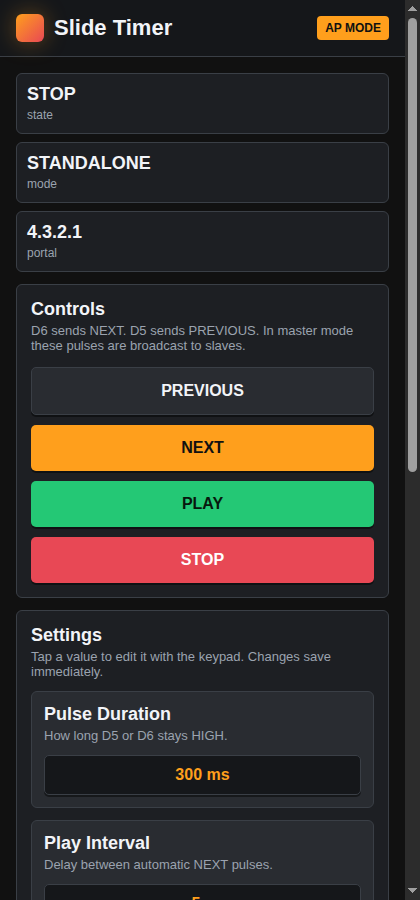
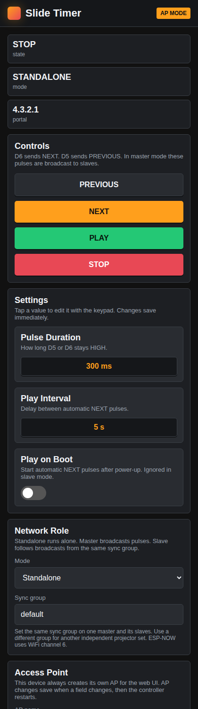
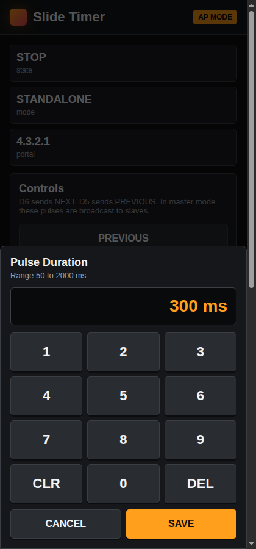
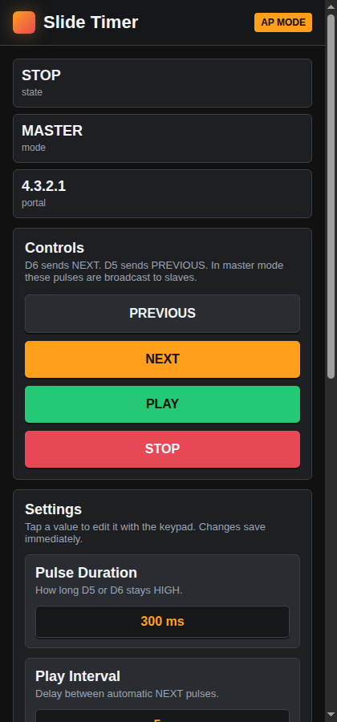

# Slide Projector Timer

Standalone / Master / Slave slide-advance controller for Kodak Carousel-style slide projectors, built on a **Seeed Studio XIAO ESP32-C3**. Configuration and manual control happen entirely through a Wi-Fi captive portal served by the device itself — no app, no cloud, no companion computer required.

Created by Mauricio van der Maesen · Rijksakademie van beeldende kunsten, Electronics workshop.

---

## What it does

The firmware pulses two GPIO outputs (`NEXT` and `PREVIOUS`) to trigger a slide projector's remote-control inputs via a relay board wired into the projector's **DIN-6 remote port**. It can run three ways:

- **Standalone** — one controller, one projector. Runs its own timed slideshow or is driven manually from the web UI.
- **Master** — one controller drives its own projector *and* broadcasts every NEXT/PREVIOUS pulse over ESP-NOW to any Slave units in the same sync group, keeping multiple projectors in lockstep (e.g. a multi-projector dissolve/panorama installation).
- **Slave** — follows a Master's broadcast pulses; ignores its own Play/Play-on-Boot timer and only reacts to synced commands.

All settings (pulse length, play interval, mode, sync group, Wi-Fi AP name/password) are stored in non-volatile flash (`Preferences`) and persist across power cycles.

---

## Hardware

| Component | Notes |
|---|---|
| **Seeed Studio XIAO ESP32-C3** | Main controller. USB-C powered. |
| **Relay module(s)** | One relay per projector output needed (minimum 1 for NEXT-only; 2 for NEXT + PREVIOUS). Opto-isolated 5V relay modules recommended — do not wire GPIO directly into the projector. |
| **DIN-6 cable + chassis/plug connector** | Matches the projector's remote socket. Kodak Carousel DIN-6 remote pinout: pins 1–3 handle tray position (forward/reverse/common), pins 4–6 handle focus. **Only pins 1–3 are used by this project.** |
| **5V power supply** | Powers the relay module(s) independently from the XIAO (USB or a small 5V wall supply). Do **not** try to power the ESP32 from the projector's remote-port voltage — that circuit is a low-current AC signalling line, not a power rail. |

### Wiring summary

```
XIAO ESP32-C3                Relay Module              Projector DIN-6
┌──────────────┐           ┌──────────────┐          ┌─────────────────┐
│  D6 (NEXT)    ├──signal──►│ IN (NEXT)     │          │                  │
│  D5 (PREVIOUS)├──signal──►│ IN (PREVIOUS) │          │                  │
│  D0 (RESET)   │◄─ pulled to GND to factory reset      │                  │
│  5V / GND     │           │ VCC / GND ◄── separate 5V supply             │
└──────────────┘           │  NO / COM     ├──wired to──► Pin "Forward" / "Common"
                            └──────────────┘          │ (confirm by continuity-   │
                                                        │  testing the projector's │
                                                        │  original wired remote)  │
                                                        └─────────────────┘
```

> ⚠️ **Confirm your projector's exact pin assignment before wiring.** DIN-6 pin *numbering* isn't fully standardized across all Kodak Carousel sub-models. Verify which two of pins 1/2/3 are "Common" and "Forward" on your specific unit (continuity-test the original wired remote, or probe with a multimeter — see the project notes) before connecting the relay's NO contact across them.

### GPIO pin map (firmware defaults, `src/main.cpp`)

| Function | Pin | Notes |
|---|---|---|
| NEXT pulse output | `D6` | Drives the relay that triggers the projector's "Forward" line |
| PREVIOUS pulse output | `D5` | Drives the relay that triggers the projector's "Reverse" line |
| Factory reset | `D0` | Pull to GND and hold **> 3.1 seconds** at boot or during runtime to wipe all saved settings and reboot to defaults |

---

## Firmware behavior

- On boot, the device loads saved settings from flash, starts its own Wi-Fi **Access Point** with a **DNS captive portal**, and (if configured) starts ESP-NOW for Master/Slave sync.
- The captive portal auto-redirects any HTTP request to the dashboard (handles the common captive-portal detection probes used by Android/iOS/Windows: `/generate_204`, `/gen_204`, `/hotspot-detect.html`, `/connecttest.txt`, `/ncsi.txt`).
- **Pulse width** (how long the NEXT/PREVIOUS output stays HIGH) and **Play interval** (delay between automatic NEXT pulses while playing) are each configurable from 50–2000 ms and 1–600 s respectively, via an on-page numeric keypad.
- **Play on Boot** automatically starts the timed slideshow after power-up (ignored on Slave units — they only ever react to Master broadcasts).
- Changing **Network Role** (mode) or **Access Point** name/password triggers an automatic restart to apply the change.
- A **Sync group** string (hashed internally) scopes ESP-NOW broadcasts so multiple independent Master/Slave projector sets can coexist on the same WiFi channel without cross-triggering each other.

### HTTP API (used internally by the web UI, also directly scriptable)

| Endpoint | Method | Purpose |
|---|---|---|
| `/` | GET | Serves the dashboard page |
| `/next` | POST | Fires a single NEXT pulse |
| `/previous` | POST | Fires a single PREVIOUS pulse |
| `/play` | POST | Starts the automatic timed slideshow (ignored in Slave mode) |
| `/stop` | POST | Stops the slideshow and any active pulse |
| `/api/number` | POST | Body: `key=pulse\|interval&value=<n>` — updates pulse duration (ms) or play interval (s) |
| `/api/boot` | POST | Body: `value=0\|1` — toggles Play on Boot |
| `/api/mode` | POST | Body: `mode=0\|1\|2` — sets Standalone/Master/Slave, then restarts |
| `/api/sync` | POST | Body: `group=<name>` — sets the ESP-NOW sync group |
| `/api/ap` | POST | Body: `ssid=<name>&pass=<password>` — sets AP credentials, then restarts |

---

## Getting started

### 1. Build and flash

This is a [PlatformIO](https://platformio.org/) project targeting the `seeed_xiao_esp32c3` board with the Arduino framework.

```bash
# from the project root
pio run                      # build
pio run --target upload      # flash over USB
pio device monitor           # view serial output (115200 baud)
```

Or open the folder in VS Code with the PlatformIO extension installed.

### 2. Connect to the device

1. Power the XIAO ESP32-C3 via USB (or your enclosure's wiring).
2. On your phone or laptop, join the Wi-Fi network it broadcasts:
   - **Default SSID:** `Slide Timer-<unique suffix derived from the board's MAC address>`
   - **Default password:** `slidetimer`
3. Most devices will auto-open the captive portal page. If not, browse to `http://4.3.2.1`.

### 3. Configure

From the dashboard you can:
- Trigger **PREVIOUS / NEXT** manually, or **PLAY / STOP** the automatic timer.
- Set **Pulse Duration** and **Play Interval** via the numeric keypad.
- Toggle **Play on Boot**.
- Set the **Network Role** (Standalone / Master / Controlled-Slave) and **Sync group** (for Master/Slave setups).
- Rename the **Access Point** and change its password (triggers a restart).

### 4. Factory reset

Hold the `D0` pin to GND for more than ~3 seconds (either at boot or during normal operation) to wipe all saved settings — pulse duration, play interval, mode, sync group, AP name/password — back to firmware defaults, then the device reboots.

---

## Multi-projector (Master / Slave) setup

1. Flash the same firmware to every controller.
2. On the unit wired to the "lead" projector, set **Network Role → Master**.
3. On each additional controller (one per follower projector), set **Network Role → Controlled / Slave**.
4. Give the Master and all its Slaves the **same Sync group** name (any string, case-sensitive) — units with different sync groups ignore each other's broadcasts, so you can run multiple independent projector sets within range on the same Wi-Fi channel (ESP-NOW channel 6) without interference.
5. Trigger NEXT/PREVIOUS or PLAY on the Master's dashboard (or its physical remote wiring) — every Slave in the same sync group fires the identical pulse in near-real-time over ESP-NOW.

> Slaves ignore their own **Play on Boot** / timer settings entirely — they only ever move in response to a Master's broadcast, so projectors stay in lockstep by design.

---

## Captive Portal — Screenshots

| Dashboard (Standalone mode) | Full dashboard (Settings / Network / AP) |
|---|---|
|  |  |

| Numeric keypad (editing Pulse Duration) | Dashboard in Master mode |
|---|---|
|  |  |

---

## Project structure

```
slide-projector-timer/
├── src/
│   └── main.cpp          # Full firmware: web server, captive portal, ESP-NOW sync, settings
├── docs/
│   └── screenshots/       # Captive portal UI screenshots (this README)
├── platformio.ini         # PlatformIO environment: seeed_xiao_esp32c3, Arduino framework
└── README.md
```

---

## License

MIT — see header in `src/main.cpp`.
